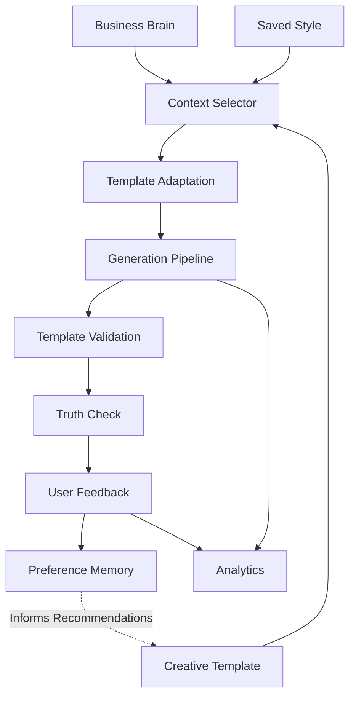

# Creative Template Intelligence Architecture

## 1. Executive Summary

The Creative Intelligence system in Mitra represents a fundamental architectural separation between **Business Knowledge** (facts, rules, identity) and **Creative Execution** (grammar, styling, layout).

By isolating creative grammar into deterministic *Templates* and creative aesthetics into *Saved Styles*, the AI is constrained from hallucinating business facts while still possessing the freedom to adapt content appropriately.

**Current Status:** Phases 0–14, 16–18, and 20–21 are **IMPLEMENTED** and rigorously validated. 
* **Phase 15 (Reference Style Analysis)** is deliberately **MISSING** (intentionally excluded from the current MVP path).
* **Phase 19 (Performance Intelligence)** is deliberately **MISSING / BLOCKED** (pending the existence of true post-launch performance/attribution pipelines).

---

## 2. System Architecture & Data Flow

The pipeline operates in a unidirectional data flow, ensuring that user feedback and analytics observations safely inform future recommendations without silently mutating core factual data.

### Core Abstractions

1. **Business Brain (`BusinessBrain`)**: WHAT IS TRUE ABOUT THE BUSINESS. The single authoritative source of truth containing factual constraints, brand identity, localization details, and business rules. The AI *reads* this; it never *writes* to this during creative generation.
2. **Creative Template (`CreativeTemplate`)**: WHAT CREATIVE STRUCTURE TO USE. A reusable creative grammar that determines the structural skeleton, hook style, and call-to-action logic of a creative, without containing any business-specific payload.
3. **Saved Style (`SavedStyle`)**: HOW THE CREATIVE SHOULD FEEL. Tone, aesthetic constraints, visual direction, and localization preferences. A business can apply the *same* template in *different* styles.
4. **Context Selector**: WHAT THE AI NEEDS TO KNOW. Filters the massive `BusinessBrain` payload down to only the facts strictly relevant to the current objective, minimizing prompt length and preventing off-topic hallucination.
5. **Template Adaptation**: HOW IT BECOMES A CREATIVE. The AI phase that maps the filtered context into the chosen template's structural blueprint, generating the final semantic plan.
6. **Generation Pipeline**: HOW IT IS RENDERED. The existing robust execution layer (Compositor for POSTs, FFmpeg/VisionAI for REELs) that turns the blueprint into final media.
7. **Truth Check**: FINAL FACTUAL AUTHORITY. The post-generation verification step that strictly compares the generated output against the original `BusinessBrain` to trap hallucinations before they reach the user.

---

## 3. Subsystems & Telemetry

### Feedback & Preference Memory
When users submit feedback (positive/negative sentiment) on generated creatives, the system routes this through `preferenceService`. It aggregates evidence fractionally, bounding confidence and storing explicit preference states (e.g., `preferred` or `avoided`) scoped precisely to the `businessId` and `templateId`.

*Feedback does NOT mutate the Business Brain directly.* It simply influences the preference memory system.

### Recommendations
The `recommendationService` surfaces intelligent template suggestions to users when they initiate new campaigns. It evaluates:
1. **Explicit Preferences**: Direct user actions taking highest precedence.
2. **Confidence-Weighted Evidence**: Algorithmic suggestions based on historical feedback.
3. **Compatibility**: Filtering out templates incompatible with the user's vertical, chosen objective, or format constraints (POST vs REEL).

### Analytics
Phase 21 establishes a strictly observational analytics boundary (`trackCreativeEventEndpoint`). It logs generation events, template views, selections, approvals, and rejections into a timeseries table. 
*Analytics observations do NOT implicitly mutate preference evidence or charge user credits.*

---

## 4. Security & Isolation Constraints

* **Tenant Isolation**: Feedback, preferences, saved styles, and analytics are strictly segregated by `businessId`. A business cannot access, pollute, or learn from the preferences of another business. Endpoints rigorously evaluate the server-authoritative `context.auth.uid` and perform validation via `verifyBusinessAccess`.
* **Billing Integrity**: Creative intelligence operations (evaluating recommendations, recording analytics) are strictly segregated from the credit ledger. They do not bypass reservations, consume credits implicitly, or circumvent finalization procedures.
* **Safe Telemetry Data**: The analytics ingress pipeline aggressively scrubs sensitive identifiers (`businessBrain`, `paymentData`, `prompts`, `creditCard`, `secrets`) from arbitrary payload metadata.

---

## 5. Excluded Scope (The MVP Gate)

To maintain a durable, stable architecture, the following capabilities have been defined but are currently excluded from the active implementation:

* **Phase 15 (Reference Style Analysis)**: Analyzing user-uploaded reference images via Vision AI to dynamically extract and build a `SavedStyle`. This is a downstream personalization feature omitted from the MVP.
* **Phase 19 (Performance Intelligence)**: Automatically ranking templates globally based on actual conversion rates, attribution metrics, or external ROAS data. Because true outcome data pipelines do not yet exist, this phase remains deliberately blocked to prevent the AI from generating falsified or statistically insignificant "quality" rankings based solely on UI clicks.
