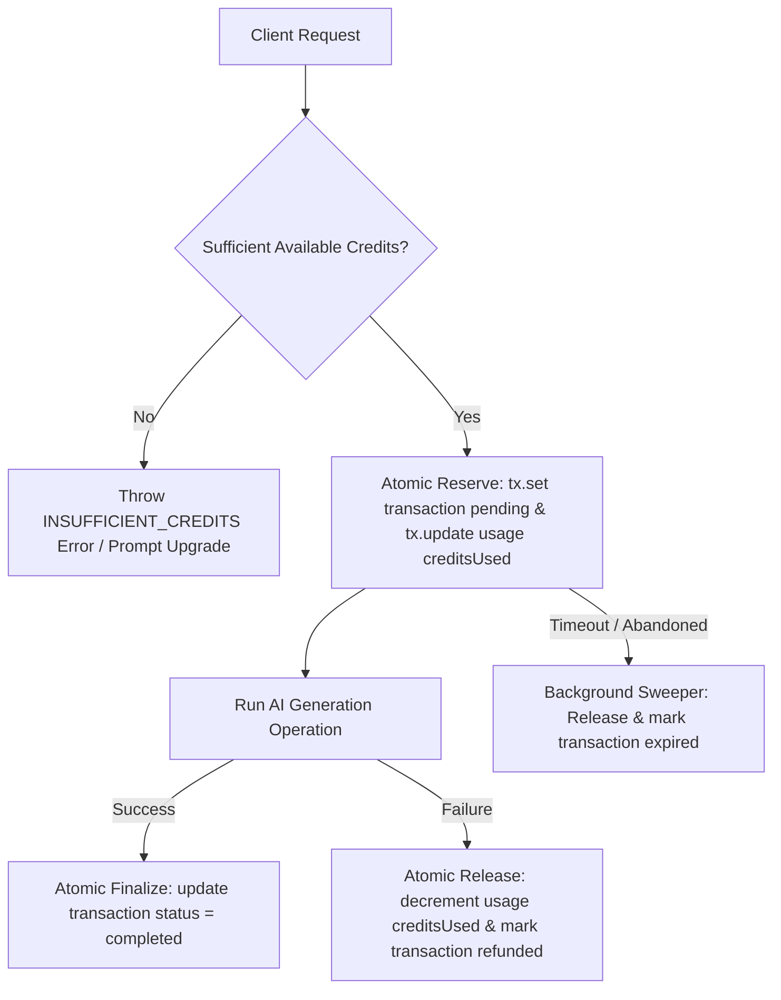

# MITRA — PHASE 19 BILLING GAP REPORT & ARCHITECTURAL SPECIFICATION

## Executive Summary

This report audits the existing billing, usage control, credit transaction, and payment provider integrations in **Mitra by Brainwise** to evaluate readiness for **Phase 19 — Production Credit Billing System**.

The foundational principle of Mitra's billing architecture is:
$$\text{1 Credit} = \text{₹1 INR}$$

Credits represent the business user's prepaid balance. Billing must operate strictly as a **separate domain boundary** from AI Generation and Publishing engines, meeting exclusively at the **Credit Ledger** (`usage` and `transactions` collections).

---

## 1. Audit of Existing Billing Infrastructure

### 1.1 Pricing Configuration (`functions/src/config/pricing.ts`)

- **Canonical Valuation**: `creditValueINR: 1`.
- **Subscription Tiers**:
  - `free`: 100 monthly credits, ₹0/month.
  - `starter`: 500 monthly credits, ₹999/month.
  - `business`: 1,200 monthly credits, ₹1,699/month.
  - `agency`: 3,000 monthly credits, ₹3,200/month.
- **Top-Up Credit Packs**:
  - Small Pack: 500 credits for ₹499.
  - Medium Pack: 1,200 credits for ₹999.
  - Large Pack: 3,000 credits for ₹1,999.
- **Operation Costs**:
  - `campaign_generation`: 140 credits (100 base + 2 × 20 image generation).
  - `createCampaignFromCalendarItem`: 140 credits.
  - `regeneration`: 10 credits.
  - `image_generation`: 20 credits.
  - `reel_generation`: 80 credits.
  - `style_analysis`: 15 credits.
  - `calendar_planning` (Phase 14): 0 credits (low-cost strategic planner before expensive creative generation).
  - Scheduling (Phase 11), Publishing (Phase 10), Analytics (Phase 16), Meta Sync (Phase 17): 0 credits.

### 1.2 Usage Control & Reservation Pipeline (`functions/src/services/usageControl.ts`)

- **Lifecycle**: `reserveCreditsForOperation` $\rightarrow$ `executeWithUsageControl` $\rightarrow$ `finalizeReservation` (on success) OR `refundReservation` (on failure).
- **Idempotency**: Checked inside atomic Firestore transactions on `transactions/{idempotencyKey}` to prevent double-charging or duplicate generation.
- **Period Derivation**: Usage documents are keyed per UTC calendar month: `usage/{userId}_{YYYY-MM-01}`.

### 1.3 Firestore Ledger Models (`functions/src/types/index.ts`)

- **`Usage` Document**:
  - `usageId`: `${userId}_${YYYY-MM-01}`
  - `creditsIncluded`: Total credits granted for the period (subscription + top-up).
  - `creditsUsed`: Total credits currently reserved or deducted in the period.
- **`Transaction` Document**:
  - `transactionId`: Idempotency key or payment gateway reference.
  - `userId`, `amount`, `currency`, `balanceAfter`, `type` (`reservation` | `deduction` | `refund` | `subscription` | `credit_purchase`), `status` (`pending` | `completed` | `failed` | `refunded` | `expired`).

---

## 2. Identified Gaps & Vulnerabilities

### Gap 1: Legacy Firestore Helper Period Keying Bug

- **Location**: `functions/src/services/firestore.ts` line 665 (`refundCredits`).
- **Issue**: `refundCredits` uses `new Date()` instead of `currentPeriodStart()`. On any day other than the 1st of the month, refunds were attempted against a non-existent daily usage doc `${userId}_${YYYY-MM-DD}` rather than the user's monthly usage doc `${userId}_${YYYY-MM-01}`.
- **Resolution**: Refactor `firestore.ts` to use `currentPeriodStart()` uniformly or delegate all credit lifecycle calls directly through `usageControl.ts`.

### Gap 2: Absence of Stale Reservation Expiration Sweeper

- **Issue**: If an AI generation function terminates unexpectedly (e.g. unhandled function timeout before calling `refundReservation`), the transaction doc remains in `pending` state and `creditsUsed` remains elevated.
- **Resolution**: Implement a background cleanup routine (`cleanupExpiredReservations`) that sweeps pending reservations older than 15 minutes, releases reserved credits, and sets status to `expired`.

### Gap 3: Missing One-Time Top-Up Pack Purchase Support

- **Location**: `src/app/billing/page.tsx` & backend subscription services.
- **Issue**: Top-up credit packs are displayed as "coming soon" in UI without backend order creation endpoints for standalone credit purchases.
- **Resolution**: Implement `createCreditPackOrder` callable Cloud Function and extend payment webhooks (`cashfreeWebhook`, `payuWebhook`, `razorpayWebhook`) to process `credit_purchase` order types.

### Gap 4: Frontend Credit Balance & Ledger Visibility

- **Issue**: The current `/billing` page shows plan details, but lacks real-time display of:
  - Total Available Credits vs Reserved Credits.
  - Itemized Transaction History table with type, status, amount, and timestamp.
  - User-facing modal/toast for `INSUFFICIENT_CREDITS` errors during generation.
- **Resolution**: Enhance `src/app/billing/page.tsx` to read user usage and transactions, displaying available/reserved balances and full ledger history.

---

## 3. Implementation Plan

1. **Step 1: Fix Legacy Firestore Helpers & Types**:
   - Update `functions/src/types/index.ts` and `src/types/index.ts` to include `expired` transaction status and credit top-up types.
   - Fix period keying in `functions/src/services/firestore.ts`.
2. **Step 2: Enhance `usageControl.ts` with Reservation Sweeper**:
   - Add `cleanupExpiredReservations` to release reservations pending > 15 minutes.
3. **Step 3: Top-Up Credit Pack Backend Endpoints**:
   - Add `createCreditPackOrder` callable function for Cashfree/PayU/Razorpay.
   - Handle `credit_purchase` in webhooks, incrementing `creditsIncluded` upon payment confirmation.
4. **Step 4: Frontend Billing Page & Transaction History UI**:
   - Display Available Credits, Reserved Credits, and Top-Up Pack purchase triggers.
   - Display Transaction History table.
5. **Step 5: Testing & Full Verification**:
   - Unit tests for credit reservation, capture, release, expiration, idempotency, and top-up grant.
   - Build, lint, and typecheck verification across `functions` and frontend app.
