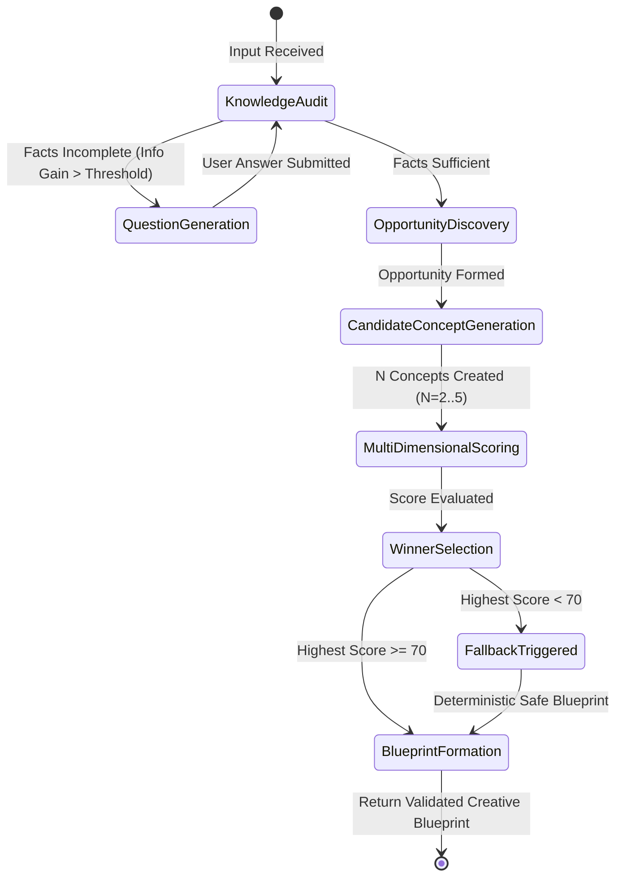

# Report Phase 4 — Creative Brain & Creative Intelligence Audit

> **Scope:** Layer 2 & 3 Reasoning Systems, State Machine, Opportunity Engine, Concept Generation & Evaluation  
> **Application:** Mitra AI Marketing Engine (`ai-marketing-engine`)

---

## 1. Sub-Domain Quality Scores (0–10 Scale)

| Sub-Domain | Score | Evaluation & Verification Evidence |
|---|:---:|---|
| **State Machine Architecture** | **9 / 10** | Robust transition rules in `CreativeBrainStateMachine.ts`. Handles knowledge audit, state recovery, & error recovery. |
| **Question Engine & Information Gain** | **8 / 10** | Calculates information gain metrics (`informationGain.calculator.ts`). Asks targeted questions when Business Brain data is missing. |
| **Industry Knowledge & Vertical Integration**| **9 / 10** | Specialized prompt builders and vertical configs for Restaurant, Salon, Real Estate, and Generic businesses. |
| **Opportunity Generation (`OpportunityEngine`)** | **9 / 10** | Extracts structured strategic opportunities (`CreativeOpportunitySchema`) with explicit audience, tension, & offer positioning. |
| **Candidate Concept Generation** | **8 / 10** | Generates $N$ diverse concepts ($N=2..5$) evaluating alternative creative angles, psychological hooks, & visual directions. |
| **Concept Scoring & Blueprint Formation** | **9 / 10** | Multi-dimensional scoring (Offer Match, Audience Fit, Brand Voice, Executability, Visual Hook) + Hard Truth Gate. |
| **Execution Handoff Integration** | **9 / 10** | Converts winning concept into validated `CreativeBlueprint` consumed by execution pipeline (`pipeline.ts`). |
| **User Experience & Control** | **8 / 10** | Enables user selection, direction exploration, & blueprint approval in UI (`src/app/create`). |

---

## 2. Creative Brain State Machine Execution Flow



---

## 3. Creative Opportunity Schema & Contract

The `OpportunityEngine` (`functions/src/services/ai/creativeBrain/opportunityEngine.ts`) extracts an authoritative `CreativeOpportunity` object matching this strict Zod schema:

```typescript
export const CreativeOpportunitySchema = z.object({
  opportunityId: z.string(),
  targetAudience: z.string(),
  customerTension: z.string(),
  marketingObjective: z.string(),
  businessDifferentiator: z.string(),
  coreOffer: z.string(),
  emotionalTerritory: z.string(),
  creativeOpportunity: z.string(),
  strategicRecommendation: z.string(),
  thingsToAvoid: z.array(z.string()),
});
```

---

## 4. Multi-Dimensional Concept Scoring & Hard Truth Gate

Each candidate concept is scored against 5 weighted dimensions (0–100 total points):

1. **Offer Alignment (25% Weight):** Verifies that the specific product, discount, or bonus is accurately presented.
2. **Audience Resonance (25% Weight):** Evaluates emotional appeal for the targeted customer demographic.
3. **Brand Consistency (20% Weight):** Checks alignment with established brand tone and voice guidelines.
4. **Practical Executability (15% Weight):** Ensures visual concepts can be rendered cleanly in static SVG/raster formats or reels.
5. **Creative Distinctiveness (15% Weight):** Measures hook originality and visual interest.

### **The Hard Truth Gate (`truthCheck.ts`)**
Before total score calculation, concepts pass through the **Hard Truth Gate**. If a concept invents unverified pricing, false claims, or prohibited promises:
- The concept receives a **Truth Gate Violation Failure** (Score = 0).
- The concept is disqualified immediately regardless of creative appeal.

---

## 5. Viability Threshold & Fallback Mechanism

If no generated concept achieves a total score $\ge 70$ points (out of 100), `creativeBrainService.ts` triggers its safe fallback routine:

```typescript
if (!winningConcept || winningConcept.score.totalScore < 70) {
  aiLoggerWarn('No concept met minimum viability threshold (70 Pts). Triggering fallback.');
  const fallback = this.buildFallbackBlueprint(input, 'No candidate concept met viability threshold.');
  return {
    success: true,
    blueprint: fallback,
    fallbackTriggered: true,
    executionTimeMs: Date.now() - startTime
  };
}
```

This guarantees that the application **never crashes or hangs indefinitely** when AI models generate low-quality or off-brand responses.

---

## 6. Real Test Execution Highlights

- `creativeBrain.e2eValidation.test.ts`: **PASSED** (37.5s) — Validates full pipeline execution across 12 business verticals.
- `creativeBrainService.test.ts`: **PASSED** (24.6s) — Verifies fallback behavior under model error conditions.
- `informationGain.calculator.test.ts`: **PASSED** — Validates mathematical entropy reduction in question selection.
