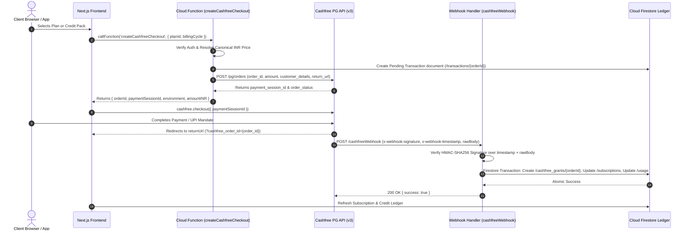

# Cashfree Billing Architecture & Specification

## 1. Executive Overview

Mitra by BrainWise uses a server-authoritative billing and credit entitlement architecture integrated with Cashfree Payments (PG REST API v3). All business logic—plan definitions, price resolution, credit allowances, subscription lifecycle management, and usage accounting—is owned by Mitra's Cloud Functions backend and stored in Cloud Firestore. Cashfree acts strictly as a secure payment gateway and mandate collector.

### Key Architectural Principles
1. **Server-Authoritative Pricing & Entitlements**: Frontend clients submit only intent parameters (`planId`, `billingCycle`, or `creditPack`). Prices in INR and credit allowances are derived exclusively on the backend from `functions/src/config/pricing.ts`.
2. **Zero Browser Secrets**: Secret Key and Webhook Secret are managed via Google Cloud Secret Manager or secure environment variables. Client code receives only short-lived `paymentSessionId` tokens.
3. **Verified Webhook Fulfillment**: Payments and credit top-ups are fulfilled only upon receipt of HMAC-SHA256 verified Cashfree webhooks (`x-webhook-signature` & `x-webhook-timestamp` calculated over `req.rawBody`).
4. **Durable Idempotency**: Credit grants are protected against duplicate, out-of-order, or retried webhooks using atomic Firestore transactions operating on `/cashfree_grants/{orderId}`.
5. **Non-Blocking Credit Enforcement**: Credit deductions occur server-side prior to AI campaign generation using optimistic reservations and atomic refunds upon execution failure.

---

## 2. Component Architecture & System Boundaries



---

## 3. Data Models & Schema Design

### 3.1 Transactions Collection (`/transactions/{orderId}`)
```typescript
interface TransactionDocument {
  transactionId: string;       // Cashfree Order ID (e.g. ord_sub_1791560000000_a1b2)
  userId: string;              // Auth UID
  type: 'subscription' | 'credit_purchase';
  status: 'pending' | 'completed' | 'failed' | 'expired';
  amount: number;              // Amount in INR
  currency: 'INR';
  description: string;
  metadata: {
    planId?: 'starter' | 'business' | 'pro' | 'agency';
    billingCycle?: 'monthly' | 'yearly';
    creditPack?: 500 | 1200 | 3000;
    creditsGranted?: number;
    paymentSessionId?: string;
  };
  createdAt: string;           // ISO timestamp
  updatedAt: string;           // ISO timestamp
}
```

### 3.2 Subscriptions Collection (`/subscriptions/{userId}`)
```typescript
interface SubscriptionDocument {
  userId: string;
  planId: 'free' | 'starter' | 'business' | 'pro' | 'agency';
  status: 'active' | 'canceled' | 'past_due' | 'unpaid';
  currentPeriodStart: string;  // ISO timestamp
  currentPeriodEnd: string;    // ISO timestamp
  cancelAtPeriodEnd: boolean;
  cashfreeOrderId?: string;
  cashfreeSubscriptionId?: string;
  creditsIncluded: number;
  maxBusinesses: number;
  updatedAt: string;
}
```

### 3.3 Cashfree Grants Idempotency Collection (`/cashfree_grants/{orderId}`)
```typescript
interface CashfreeGrantDocument {
  orderId: string;             // Document ID = Order ID
  userId: string;
  type: 'subscription' | 'credit_pack';
  planId?: string;
  creditsGranted: number;
  amount: number;
  cfPaymentId?: string;
  processedAt: string;         // Server timestamp
}
```

---

## 4. Webhook Security & Idempotency Guarantee

### 4.1 Signature Verification Protocol
Cashfree webhooks transmit signature headers:
- `x-webhook-signature`: Base64 encoded HMAC-SHA256 signature
- `x-webhook-timestamp`: Epoch timestamp string in milliseconds

The server verifies the signature using constant-time comparison:
$$\text{payload} = \text{timestamp} + \text{rawBody}$$
$$\text{computedSignature} = \text{Base64}(\text{HMAC-SHA256}(\text{payload}, \text{CASHFREE\_WEBHOOK\_SECRET}))$$

### 4.2 Idempotency Flow
Every webhook payload containing `ORDER_PAID` or `PAYMENT_SUCCESS` initiates a Firestore transaction:
1. Attempt to read `/cashfree_grants/{orderId}` within the transaction.
2. If document exists, abort credit addition and return `{ received: true, alreadyProcessed: true }`.
3. If document does not exist:
   - Create `/cashfree_grants/{orderId}`.
   - Update `/subscriptions/{userId}` with new entitlements.
   - Increment available credits in `/usage/{userId}_{period}`.
   - Mark `/transactions/{orderId}` as `completed`.

---

## 5. Failure Recovery & Edge Cases

| Scenario | Risk | Mitigation |
|---|---|---|
| Delayed Webhook | User lands on `/billing` before webhook arrives | UI displays confirming toast and polls subscription state at 3s, 7s, 15s intervals. |
| Duplicate Webhook | Duplicate credit grants | Blocked atomically by `/cashfree_grants/{orderId}` constraint in Firestore transaction. |
| Signature Tampering | Unauthorized credit injection | Request rejected with 401 Unauthorized before parsing payment body. |
| Partial Network Failure | User pays but browser disconnects | Backend webhook delivers fulfillment independently of frontend state. |
