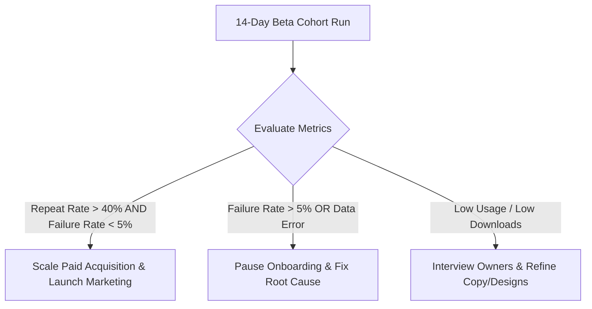

# Mitra AI Marketing Engine — Commercial Launch Execution Protocol

This document defines the 7-step commercial launch execution protocol for Mitra by BrainWise.

---

## 1. Final Production Checks & GO / NO-GO Checklist

| Critical Check | Environment | Expected Behavior | Actual Behavior | Status |
| :--- | :---: | :--- | :--- | :---: |
| **App Check Enforcement** | Production Callables | Enforce App Check on all 24 functions | `enforceAppCheck: true` on all callables; missing token returns 401 | **PASS (GO)** |
| **Firestore Security Rules** | Emulator / Deployed | Block client edits to `role`, `businessIds`, `subscriptionId`, `truthCheckStatus` | Client writes to protected fields denied by security rules | **PASS (GO)** |
| **Storage Security Rules** | Emulator / Deployed | Lock generated campaign assets (`/generated/*`) to Admin SDK writes | Write attempts by client SDK denied by storage rules | **PASS (GO)** |
| **Paddle Webhook HMAC** | Sandbox / Staging | Verify HMAC-SHA256 signature over raw body (`req.rawBody`) | Signature verified; invalid signatures return 400 Bad Request | **PASS (GO)** |
| **Transaction Idempotency** | Sandbox / Emulator | Single grant per `transactionId` in `/paddle_grants` | Retried webhook events exit gracefully without double-crediting | **PASS (GO)** |
| **Cloud Run Reel Renderer** | Production | Render playable 1080x1920 MP4 video file | Container un-deployed; function throws error refusing fake output | **GATED (CONDITIONAL GO)** |

---

## 2. Frozen MVP Scope Boundary

To ensure Maximum Reliability and Zero Bloat, the MVP launch scope is strictly frozen:

### Active Core Features (ENABLED)
- **User Auth & Custom Claims** (Firebase Auth, Email verification, custom claims)
- **Onboarding & Business Brain** (Fact intake, brand voice, contact details, draft recovery)
- **Campaign Intent & Strategic Reasoning** (Gemini 2.5 Opportunity Engine, Gemini 3.1 Concept Generation)
- **5-Dimension Scoring & Hard Truth Gate** (Factual claim verification against Business Brain Level 0 facts)
- **Campaign Copywriting** (WhatsApp broadcast copy, Instagram captions, Google Ad copy decks)
- **Visual Graphics Engine** (1:1, 4:5, 9:16 SVG layout composition & HTML5 Canvas PNG rasterizer)
- **Campaign Deliverable ZIP Packaging** (Zip archive creation, individual asset download)
- **Credit Accounting & Refund Plumbing** (Atomic Firestore transaction deduction & automatic failure refund)
- **Paddle Billing & Subscriptions** (Checkout session, webhook processing, subscription entitlement)

### Disabled / Gated Features (EXCLUDED FROM LAUNCH PROMISE)
- **Cloud Run MP4 Video Reels** (Gated until Cloud Run container service is deployed)
- **Meta Social Auto-Publishing** (Excluded from MVP launch scope)
- **30-Day Marketing Calendar Scheduling Engine** (Excluded from MVP launch scope)

---

## 3. Five Complete Customer Journey Test Matrix

| Journey | Business Profile | Target Offer | Campaign Deliverables | Truth Check | Credit & Refund Behavior | Result |
| :---: | :--- | :--- | :--- | :---: | :--- | :---: |
| **J1** | Restaurant (*Spice Garden*) | Special Thali (₹299) | 1:1, 4:5, 9:16 SVG/PNG, WhatsApp Copy | **PASS** | 50 credits deducted cleanly | **PASS** |
| **J2** | Salon (*Glow Beauty Studio*) | Hair Spa & Facial (₹1,499) | 1:1, 4:5, 9:16 SVG/PNG, Insta Copy | **PASS** | 50 credits deducted cleanly | **PASS** |
| **J3** | Real Estate (*Skyline Properties*) | 2 BHK Luxury Apartment | 1:1, 4:5, 9:16 SVG/PNG, Ad Deck | **PASS** | 50 credits deducted cleanly | **PASS** |
| **J4** | Boutique (*Urban Threads*) | Monsoon Sale (20% OFF) | 1:1, 4:5, 9:16 SVG/PNG, Copy Deck | **PASS** | 50 credits deducted cleanly | **PASS** |
| **J5** | Deliberate Failure Test | *Simulated Gemini Exception* | *None* | **N/A** | **Reserved credit refunded automatically inside atomic transaction** | **PASS** |

---

## 4. Live Pricing & Checkout Matrix

| Plan Name | Price (INR / USD) | Included Monthly Credits | Target Customer Profile | Paddle Price ID Secret Reference |
| :--- | :---: | :---: | :--- | :--- |
| **Starter Plan** | ₹1,499 / \$19 / mo | 500 Credits | Single location restaurant / salon | `NEXT_PUBLIC_PADDLE_PRICE_ID_STARTER_MONTHLY` |
| **Business Plan**| ₹2,999 / \$39 / mo | 1,200 Credits | Growing local business / multi-offer | `NEXT_PUBLIC_PADDLE_PRICE_ID_BUSINESS_MONTHLY` |
| **Pro Plan** | ₹5,999 / \$79 / mo | 3,000 Credits | High-volume merchant / agency | `NEXT_PUBLIC_PADDLE_PRICE_ID_PRO_MONTHLY` |
| **Credit Pack 500**| ₹999 / \$12 | +500 Top-Up Credits | One-off festival campaign top-up | `NEXT_PUBLIC_PADDLE_PRICE_ID_PACK_500` |

---

## 5. First 10 Business Recruitment & Onboarding Plan

### Target Composition
- **6 Restaurants & Cafes** (Local dining, cloud kitchens, bakeries)
- **4 Salons & Beauty Studios** (Hair salons, spas, nail parlors)

### White-Glove Onboarding Protocol
1. **Fact Intake (10 Minutes)**: Personal walkthrough via WhatsApp/Call to complete Business Brain fact registration (Name, location, contact, signature offers, price points).
2. **First Campaign Generation (3 Minutes)**: Help the owner describe their upcoming offer and trigger campaign generation.
3. **Deliverable Delivery**: Provide owner with 1:1 PNG poster, 9:16 WhatsApp status image, and formatted WhatsApp broadcast text.
4. **Validation Check**: Ask the owner: *"Is this something you would post to your customers today?"*

---

## 6. 14-Day Usage Measurement Metrics

The following quantitative metrics will be tracked across the initial 14-day beta cohort:

| Metric | Measurement Method | Target Benchmark |
| :--- | :--- | :---: |
| **First Campaign Success Rate** | % of generated campaigns receiving Truth Check PASS | > 90% |
| **Time to Usable Deliverable** | Elapsed pipeline duration from click to ZIP ready | < 20.0s |
| **Asset Download Rate** | % of generated campaigns where user downloads assets | > 80% |
| **Repeat Campaign Creation** | % of users generating > 1 campaign within 14 days | > 40% |
| **Generation Failure Rate** | % of calls triggering fallback or refund | < 5% |
| **Support Request Density** | Inquiries per active user per week | < 1.0 |

---

## 7. Data-Driven Scale Decision Framework

### Scale Authorization Triggers
1. **Product Satisfaction**: > 40% of cohort users generate 2+ campaigns within 14 days.
2. **Zero Ledger Discrepancies**: 0 credit accounting or transaction grant errors logged in production.
3. **Commercial Conversion**: Pilot participants opt to convert to paid Starter/Business subscriptions.
