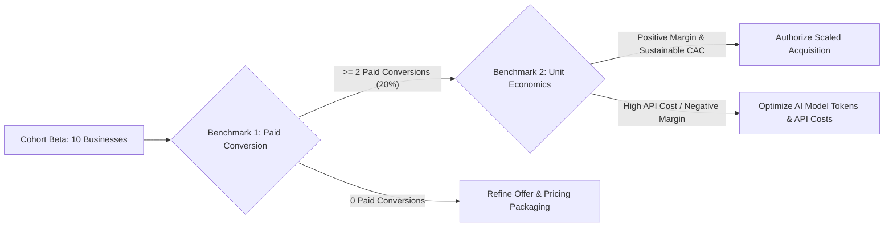

# Mitra AI Marketing Engine — Controlled Beta Pilot Protocol & Owner Execution Guide

This document defines the operational execution protocol and sample-size measurement standards for the initial 10-business controlled beta cohort.

---

## 1. Executive Action Tracking Checklist

- [ ] **1. Verify Production App Check**
  - **Task**: On the deployed domain (`brain-wise.com`), confirm valid App Check tokens are issued by reCAPTCHA Enterprise and accepted by deployed Cloud Functions. Verify that calls with missing or invalid tokens return HTTP 401/403.
  - **Status**: **PENDING LIVE DOMAIN EXECUTION**

- [ ] **2. Complete Controlled Billing Verification**
  - **Task**: Verify production Paddle products, price IDs, checkout session creation, webhook delivery, and entitlement grants. Execute a single live \$1.00 test transaction only with explicit owner authorization.
  - **Status**: **PENDING OWNER LIVE TRANSACTION**

- [ ] **3. Start 10-Business Static-Campaign Beta**
  - **Task**: Onboard 6 restaurants and 4 salons. Help owners create static campaign packs (posters, social stories, WhatsApp broadcast copy, ad decks). Keep reels, auto-publishing, and calendar scheduling excluded. Track asset acceptance, downloads, repeat usage, failures, and willingness to pay.
  - **Status**: **READY FOR COHORT ONBOARDING**

---

## 2. Cohort Measurement Denominators & Statistical Rules

With an initial cohort of $N = 10$ local businesses, percentage metrics can fluctuate significantly based on individual user actions (1 business = 10%). To maintain statistical rigor, all cohort metrics are defined with explicit mathematical denominators before pilot launch:

### Metric Definitions & Denominators

| Metric Name | Mathematical Formula | Cohort Target | Statistical Purpose |
| :--- | :--- | :---: | :--- |
| **First Campaign Success Rate** | $$\frac{N_{\text{passed}}}{N_{\text{total\_first\_attempts}}} = \frac{\text{Successful 1st Campaigns}}{\text{Total Initial Campaign Attempts}}$$ | $> 90\%$ ($9/10$) | Proves core pipeline reliability on first run |
| **Asset Download Acceptance** | $$\frac{N_{\text{downloaded}}}{N_{\text{generated}}} = \frac{\text{Campaign Packs Downloaded}}{\text{Total Verified Campaigns Generated}}$$ | $> 80\%$ ($8/10$) | Proves visual & copy quality matches owner expectations |
| **Repeat Campaign Creation** | $$\frac{N_{\text{repeat\_users}}}{N_{\text{total\_cohort}}} = \frac{\text{Businesses Creating } \ge 2 \text{ Campaigns}}{\text{Total Cohort Businesses } (N=10)}$$ | $> 40\%$ ($4/10$) | Proves ongoing product utility beyond initial trial |
| **Generation Failure Rate** | $$\frac{N_{\text{failed\_runs}}}{N_{\text{total\_generation\_calls}}} = \frac{\text{Pipeline Exceptions / Fallbacks}}{\text{Total Generation Calls}}$$ | $< 5\%$ | Measures AI model & infrastructure stability |

---

## 3. Separating Paid Conversion from Unit Economics

Demonstrating commercial viability before scaling acquisition requires satisfying two distinct commercial benchmarks:



### Benchmark 1: Paid Conversion Rate
- **Metric**: Percentage of pilot cohort businesses converting to paid monthly plans (Starter ₹1,499/mo, Business ₹2,999/mo) or top-up credit packs.
- **Threshold**: At least **2 of 10 businesses** ($20\%$) convert to a paid offer within 14 days.

### Benchmark 2: Unit Economics & Margin Sustainability
- **Metric**: Net gross margin per customer after deducting LLM token costs (Gemini 2.5/3.1 API calls), image generation costs, Firebase compute, and Paddle payment processing fees.
- **Threshold**: Direct API and compute costs must not exceed **25%** of monthly plan revenue (maintaining $\ge 75\%$ gross margin).

---

## 4. Final Controlled Beta Scope Declaration

```
======================================================================
  AUTHORIZED MVP SCOPE (FROZEN FOR BETA COHORT)
======================================================================
  [ENABLED]  Onboarding & Business Brain Fact Intake
  [ENABLED]  Strategic Opportunity Discovery & Concept Generation
  [ENABLED]  Campaign Copywriting (WhatsApp, Instagram, Google Ads)
  [ENABLED]  Visual Composition Engine (1:1, 4:5, 9:16 SVG & PNG)
  [ENABLED]  Truth Check Verification Gate
  [ENABLED]  Campaign Deliverable Zip Export & Asset Downloads
  [ENABLED]  Credit Accounting, Reservation & Automatic Refund Plumbing
  [ENABLED]  Paddle Webhooks, Subscriptions & Credit Top-ups

  [GATED]    Cloud Run FFmpeg MP4 Video Reels (Requires Container Deployment)
  [DISABLED] Meta Social Auto-Publishing (Post-MVP)
  [DISABLED] 30-Day Marketing Calendar Scheduling Engine (Post-MVP)
======================================================================
```
