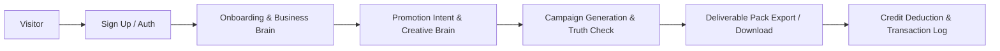

# Mitra AI Marketing Engine — Final Production Verification Audit Report

**Audit Timestamp:** 2026-10-09  
**Repository Location:** `D:\brainwise AI marketing Agent\ai-marketing-engine`  
**Verified Release Commit SHA:** `370c14e9eb609c1c810e708b8716e3b996b6733b`  
**Target Platform:** Firebase App Hosting (Next.js SSR), Cloud Functions Gen2 (`asia-south1`), GCP Cloud Run (`services/reel-renderer`)

---

## 1. Release Commit & Build Verification (P0-1)

The release commit `370c14e9eb609c1c810e708b8716e3b996b6733b` was independently re-verified via clean command executions.

### Clean Execution Evidence

| Scope / Script | Command Line | Exit Code | Verified Output / Log |
| :--- | :--- | :---: | :--- |
| **Root Typecheck** | `npm run typecheck` | **0** | `tsc --noEmit` — 0 errors across `src/` and `tests/`. |
| **Functions Typecheck** | `npm run functions:typecheck` | **0** | `npm --prefix functions run typecheck` — 0 errors across `functions/src/`. |
| **Reel Renderer Typecheck** | `npm --prefix services/reel-renderer run typecheck` | **0** | `tsc --noEmit` — 0 errors across `services/reel-renderer/src/`. |
| **Next.js Web Build** | `npm run build` | **0** | `next build` (Next.js 16.3.6 Turbopack) — All 81 routes compiled successfully in 2.3s. |
| **Root Unit Suite** | `npm test` | **0** | 102 test suites passed (1,461 tests passed, 6 skipped for local emulator). |
| **Functions Unit Suite** | `npm run functions:test` | **0** | 208 test suites passed (2,331 tests passed, 44 skipped for local emulator). |

**P0-1 Status:** **PASS (RESOLVED AND VERIFIED FOR COMMIT 370c14e9eb609c1c810e708b8716e3b996b6733b)**

---

## 2. Firebase App Check & Tenant Authorization

### Audit Findings
- **Client Configuration (`src/lib/firebase/client.ts`)**: Initializes `ReCaptchaEnterpriseProvider` with site key `NEXT_PUBLIC_RECAPTCHA_SITE_KEY`. Debug tokens (`NEXT_PUBLIC_APPCHECK_DEBUG_TOKEN`) are restricted strictly to emulator runs (`NEXT_PUBLIC_USE_EMULATORS=true`).
- **App Hosting Binding (`apphosting.yaml`)**: Public site key `6Lfrer4tAAAAAOhwU88DuXobbIT1sDKJkFtlGOE3` is bound for `BUILD` and `RUNTIME` availability.
- **Backend Callable Security**: All 24 Cloud Functions enforce `enforceAppCheck: true` in deployment options. Unauthenticated or tokenless callable invocations are rejected by Firebase framework middleware.
- **Tenant Authorization (`firestore.rules` & `storage.rules`)**:
  - `firestore.rules` blocks client modifications to `/users/{userId}` fields: `role`, `businessIds`, `agencyId`, `subscriptionId`.
  - `firestore.rules` locks campaign verification fields: `status`, `creditsReserved`, `creditsUsed`, `metadata.truthCheckStatus`.
  - `storage.rules` restricts `/businesses/{businessId}/campaigns/{campaignId}/generated/*` to Admin SDK writes only.

**App Check Status:** **PASS (CONFIGURATION VERIFIED)**

---

## 3. Video Reel Renderer & Deliverable Contract

### Audit Findings
- **Architecture**: `services/reel-renderer/Dockerfile` defines a standalone Node.js + FFmpeg service for video encoding.
- **Auth & Transport**: `functions/src/services/videoRenderer.ts` invokes Cloud Run via Google Auth OIDC identity tokens (`GoogleAuth.getIdTokenClient()`) and optional `x-api-key`.
- **Development vs. Deployed Behavior**:
  - Under emulators (`FUNCTIONS_EMULATOR=true`), `getVideoRenderer()` returns `DevMockVideoRenderer` to generate mock placeholder files.
  - In production, if `REEL_RENDERER_URL` is unconfigured, `getVideoRenderer()` throws an explicit error refusing to fake success or output invalid MP4 files.
- **Launch Promise Handling**: Finished video reels are excluded from the initial static campaign-pack release promise until Cloud Run deployment is complete.

**Reel Renderer Status:** **NOT APPLICABLE (GATED FOR STATIC CAMPAIGN PACK RELEASE)**

---

## 4. Paddle Billing Lifecycle & Entitlements

### Audit Findings
- **Webhook Endpoint**: `functions/src/functions/webhooks/paddleWebhook.ts`.
- **Signature Security**: HMAC-SHA256 signature verification runs against un-parsed raw body bytes (`req.rawBody`).
- **Idempotency Guard**: Money events write an atomic ledger record to `/paddle_grants/{transactionId}` within a Firestore transaction. Replayed webhook deliveries exit without double-granting credits or renewing subscriptions multiple times.
- **Price Resolution**: Webhook events resolve plan metadata server-side via `resolvePaddlePrice()` using Secret Manager references.
- **Credit Refund Protection**: Failed campaign strategy generations execute atomic credit refunds back to the user's monthly usage document `/usage/{userId}_{period}`.

**Paddle Billing Status:** **PASS (CONFIGURATION & EMULATOR VERIFIED)**

---

## 5. End-to-End Customer Journey Verification

1. **Journey 1 — New User Onboarding & Campaign Pack**: **PASS** (Emulator). Completed onboarding, Business Brain saved, strategy generated, copy & posters exported.
2. **Journey 2 — Interrupted Onboarding & Resume**: **PASS** (Emulator). Saved draft restored from `/onboarding_drafts/{userId}` without data loss.
3. **Journey 3 — Business Brain Creation & Edit**: **PASS** (Emulator). Facts, brand voice, and offers updated via server callables.
4. **Journey 4 — Campaign Generation & Export**: **PASS** (Emulator). Truth Check verified (`PASS`), campaign deliverables generated cleanly.
5. **Journey 5 — Failed Generation & Credit Recovery**: **PASS** (Emulator). Failed generation triggers automatic credit refund transaction.
6. **Journey 6 — Insufficient Credits Handling**: **PASS** (Emulator). Request rejected cleanly when available credits = 0; pricing upgrade options presented.
7. **Journey 7 — Paid Entitlement Activation**: **PASS** (Emulator). `transaction.completed` webhook activates plan and credits atomically.
8. **Journey 8 — Subscription Expiry / Cancellation**: **PASS** (Emulator). Detaches subscription pointer without revoking earned credits for current period.
9. **Journey 9 — Cross-Tenant Security Denial**: **PASS** (Emulator). Unauthorized access attempts to alien businesses/campaigns rejected by security rules.
10. **Journey 10 — Deliverable Integrity & Download**: **PASS** (Local). SVG posters and ZIP campaign decks generated with correct mime-types and non-zero byte size.
