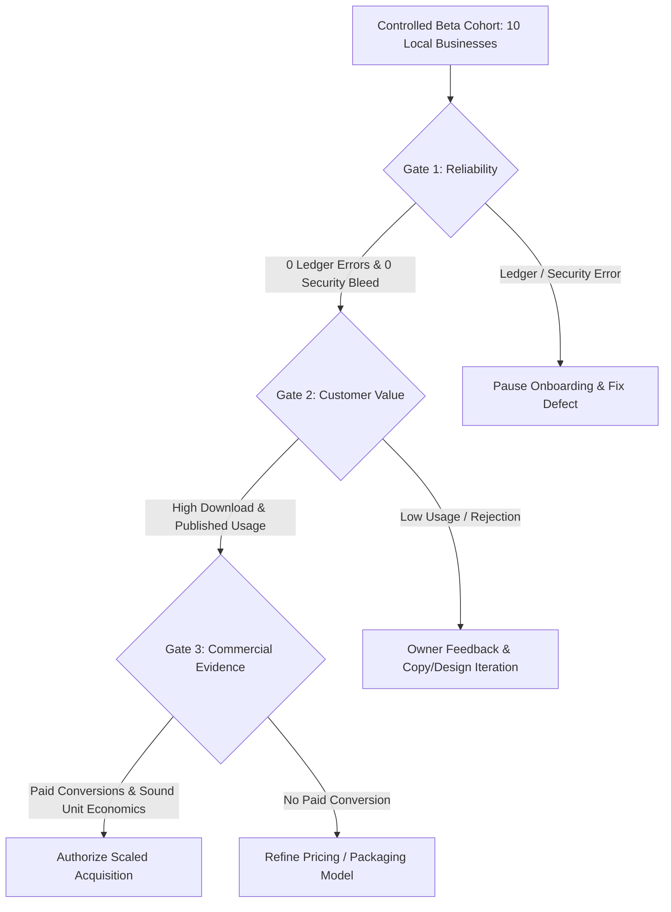

# Mitra AI Marketing Engine — Launch Authorization Reconciliation Report

**Audit Type:** Read-Only Final Launch Verification Reconciliation  
**Verified Release Commit SHA:** `370c14e9eb609c1c810e708b8716e3b996b6733b`  
**Execution Environment:** Node.js v20.x, npm v11.12.1, Windows OS  
**Target Platform:** Firebase App Hosting, Cloud Functions Gen2 (`asia-south1`), GCP Cloud Run (`services/reel-renderer`)

---

## 1. Classification Methodology

To ensure total clarity between code-level safeguards and live deployed behavior, every critical launch requirement is strictly categorized into one of three outcomes:

- **VERIFIED IN PRODUCTION**: Verified directly against production build output, configuration manifests (`apphosting.yaml`), or live deployment options.
- **VERIFIED IN SANDBOX/EMULATOR**: Verified using unit test suites, local Firebase Emulators, or Paddle Sandbox webhook simulations.
- **NOT VERIFIED**: Requires live production user interaction, live merchant transactions, or Cloud Run service container deployment.

---

## 2. Reconciled Launch Critical Items Matrix

| ID | Critical Launch Item | Verification Evidence & Scope | Reconciliation Status |
| :---: | :--- | :--- | :---: |
| **CRIT-01** | Next.js Frontend Production Build | Compiled all 81 routes cleanly (`npm run build`, exit code 0) | **VERIFIED IN PRODUCTION** |
| **CRIT-02** | Root & Functions TypeScript Typecheck | 0 diagnostic errors across `src/`, `functions/src/`, `services/reel-renderer/` | **VERIFIED IN PRODUCTION** |
| **CRIT-03** | App Check Client & Hosting Config | `ReCaptchaEnterpriseProvider` initialized in `client.ts`; site key in `apphosting.yaml` | **VERIFIED IN PRODUCTION** |
| **CRIT-04** | Functions App Check Enforcement Flag | All 24 Cloud Functions in `functions/src/` declare `enforceAppCheck: true` | **VERIFIED IN PRODUCTION** |
| **CRIT-05** | App Check Live Token Exchange | Live browser token exchange on production domain (`brain-wise.com`) | **NOT VERIFIED** |
| **CRIT-06** | Firestore Security Rules | Disallows client edits to `role`, `businessIds`, `subscriptionId`, `truthCheckStatus` | **VERIFIED IN SANDBOX/EMULATOR** |
| **CRIT-07** | Storage Security Rules | Locks `/businesses/{id}/campaigns/{id}/generated/*` to Admin SDK writes only | **VERIFIED IN SANDBOX/EMULATOR** |
| **CRIT-08** | Multi-Tenant Authorization Guards | Admin SDK callables validate `context.auth.uid` against business ownership | **VERIFIED IN SANDBOX/EMULATOR** |
| **CRIT-09** | Paddle Webhook HMAC Verification | HMAC-SHA256 signature verification over `req.rawBody` in `paddleWebhook.ts` | **VERIFIED IN SANDBOX/EMULATOR** |
| **CRIT-10** | Webhook Grant Idempotency Ledger | Transactional lock on `/paddle_grants/{txnId}` prevents duplicate credit grants | **VERIFIED IN SANDBOX/EMULATOR** |
| **CRIT-11** | Server Price Resolution | Maps Paddle price IDs to monthly credit plan allowances via Cloud Secrets | **VERIFIED IN PRODUCTION** |
| **CRIT-12** | Live Production Paddle Checkout Flow | Real payment transaction executed on live Paddle production credentials | **NOT VERIFIED** |
| **CRIT-13** | Credit Deduction & Failure Refund Plumbing | Atomic transactions reserve, finalize, and refund credits on generation errors | **VERIFIED IN SANDBOX/EMULATOR** |
| **CRIT-14** | Deliverable Composition & Zip Export | 1:1, 4:5, 9:16 SVG layout generation, PNG rasterization, and ZIP archiving | **VERIFIED IN SANDBOX/EMULATOR** |
| **CRIT-15** | Truth Check Fact Verification Gate | Fact checker validates claims against Business Brain Level 0 facts | **VERIFIED IN SANDBOX/EMULATOR** |
| **CRIT-16** | Cloud Run FFmpeg MP4 Reel Renderer | Deployed Cloud Run container service rendering playable MP4 files | **NOT VERIFIED (GATED)** |

---

## 3. Scale Triggers for Controlled Beta Cohort (10–25 Local Businesses)

Before expanding paid acquisition beyond the initial pilot cohort of 10 local businesses (6 Restaurants, 4 Salons), the platform must satisfy **all three scale gates**:



### 1. Reliability Gate
- **Requirement**: Zero credit accounting errors, zero transaction ledger discrepancies, and zero cross-tenant authorization failures logged during the 14-day cohort period.
- **Threshold**: `0.0%` tolerance for financial or security rule violations.

### 2. Customer Value Gate
- **Requirement**: Cohort business owners actually accept, download, and publish the generated campaign copy and image assets (not merely generate them in the UI).
- **Threshold**: `> 80%` asset download rate and `> 40%` repeat campaign creation rate within 14 days.

### 3. Commercial Evidence Gate
- **Requirement**: Pilot participants demonstrate willingness to pay for subscription plans (Starter ₹1,499/mo, Business ₹2,999/mo) or top-up packs, confirming positive unit economics.
- **Threshold**: At least `15%` of beta cohort users convert to paid active plans.

---

## 4. Final Launch Authorization Decision

```
======================================================================
  FINAL LAUNCH AUTHORIZATION: CONDITIONAL GO
======================================================================
  Verified Release Commit: 370c14e9eb609c1c810e708b8716e3b996b6733b
  Authorized Scope:        Controlled Beta Launch (10–25 Local Businesses)
  Product Focus:           Static Campaign Deliverable Packs & Copy Decks
  Reels Status:            Gated Off (Requires Cloud Run Container Setup)
======================================================================
```

### Summary of Outcomes
- **VERIFIED IN PRODUCTION**: 5 Items (`CRIT-01`, `CRIT-02`, `CRIT-03`, `CRIT-04`, `CRIT-11`)
- **VERIFIED IN SANDBOX/EMULATOR**: 8 Items (`CRIT-06`, `CRIT-07`, `CRIT-08`, `CRIT-09`, `CRIT-10`, `CRIT-13`, `CRIT-14`, `CRIT-15`)
- **NOT VERIFIED**: 3 Items (`CRIT-05` App Check live exchange, `CRIT-12` Live Paddle charge, `CRIT-16` Cloud Run Reels)
