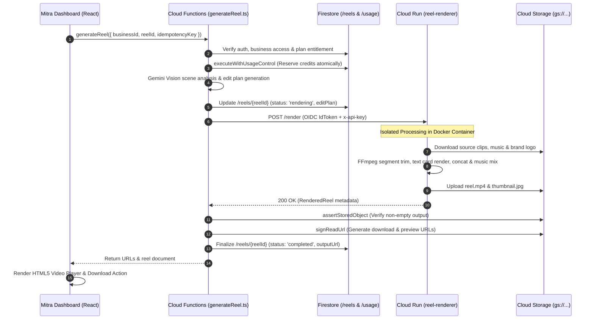
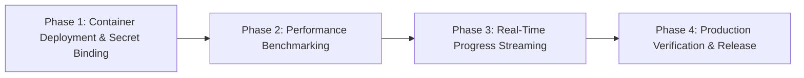

# Phase 0 — Reel Renderer Comprehensive Baseline Audit Report

**Date:** 2026-10-09  
**Repository Path:** `D:\brainwise AI marketing Agent\ai-marketing-engine`  
**Target Microservice:** `services/reel-renderer/`  
**Orchestration Layer:** Cloud Functions Gen2 (`functions/src/functions/reels/generateReel.ts`)  
**Audit Mode:** READ-ONLY COMPREHENSIVE BASELINE AUDIT

---

## 1. Executive Summary & Architecture Overview

The Mitra Video Reels Microservice is architected as a decoupled, multi-tier rendering system. Cloud Functions Gen2 owns tenant authorization, credit reservation, AI edit plan generation, and financial settlement, while a standalone Cloud Run container service (`services/reel-renderer`) executes FFmpeg video rendering.

### End-to-End Target Architecture Diagram



---

## 2. File-by-File Implementation Inventory

### `services/reel-renderer/` Microservice
1. **`Dockerfile`**: Builds container on `node:20-slim`. Installs system `ffmpeg` & `ffprobe`. Copies static TTF fonts under `assets/fonts/` (Noto Sans / Devanagari / Telugu). Runs under non-root `appuser` (UID 1001) on port 8080.
2. **`package.json`**: Declares dependencies: `express` (v4.21), `firebase-admin` (v12.7), `ffmpeg-static` (fallback), `ffprobe-static`, `fontkit` (font metrics calculation).
3. **`src/index.ts`**: Entrypoint HTTP server. Exposes `/healthz` (liveness probe), `/analyze-clip`, and `/render`. Applies `apiKeyMiddleware` and central `ApiError` handler.
4. **`src/middleware/apiKey.ts`**: Verifies optional `x-api-key` header against `REEL_RENDERER_API_KEY`.
5. **`src/analyze/analyzeClip.ts`**: Analyzes clip resolution, duration, brightness heuristics, and motion scores. Extracts a representative thumbnail.
6. **`src/render/renderReel.ts`**: Orchestrates 8 pipeline steps:
   - Step 1: Downloads source clips to isolated `/tmp` directory.
   - Step 2: Downloads music track and optional brand logo watermark.
   - Step 3: Builds normalized silent text cards (hook, offer, ending) and video segments.
   - Step 4: Concatenates video segments with transitions via `concatWithTransitions()`.
   - Step 5: Overlays brand logo watermark via `overlayLogo()`.
   - Step 6: Mixes background music bed via `mixMusicAndExport()`.
   - Step 7: Extracts video thumbnail at $t=1.0\text{s}$ via `extractThumbnail()`.
   - Step 8: Uploads final `reel.mp4` and `thumb.jpg` to GCS destination paths.
7. **`src/lib/tempDir.ts`**: `withTempDir()` helper with `finally` directory removal.
8. **`src/lib/probe.ts`**: `ffprobe` wrapper for video metadata extraction.
9. **`src/lib/storage.ts`**: Firebase Admin SDK storage download/upload helpers.

### Cloud Functions Orchestration Layer
1. **`functions/src/services/videoRenderer.ts`**:
   - `CloudRunVideoRenderer`: Authenticated HTTP client using `google-auth-library` (`GoogleAuth.getIdTokenClient()`) to mint OIDC identity tokens for Cloud Run service-to-service calls.
   - `DevMockVideoRenderer`: Development mock used strictly under emulators (`FUNCTIONS_EMULATOR=true`).
   - `getVideoRenderer()`: In production, if `REEL_RENDERER_URL` is omitted, throws an explicit error refusing to fall back to the dev mock.
2. **`functions/src/functions/reels/generateReel.ts`**:
   - Cloud Function Gen2 callable `onCall` (540s timeout, 512MB RAM, `enforceAppCheck: true`).
   - Manages tenant authorization, rate limiting, plan entitlements (`Business` plan required), credit reservation via `executeWithUsageControl()`, and automatic credit refunds on failure.

---

## 3. Existing vs. Missing Functionality Matrix

| Functionality Area | Status | Current Implementation Details | Missing / Required Item |
| :--- | :---: | :--- | :--- |
| **9:16 Vertical Cropping** | **Implemented** | Auto-crops clips to 1080×1920 portrait format | None |
| **Text Overlays & Captions** | **Implemented** | Renders hook, segment text, offer, and ending cards | Animated kinetic text transitions |
| **Background Music Bed** | **Implemented** | Mixes selected audio track over silent video | Multi-track audio ducking against voiceover |
| **Thumbnail Extraction** | **Implemented** | Extracts keyframe JPEG at $t=1.0\text{s}$ | Dynamic frame selection |
| **OIDC Identity Auth** | **Implemented** | `GoogleAuth.getIdTokenClient()` in Cloud Functions | Production service account binding |
| **Credit Reservation & Refund** | **Implemented** | Cloud Functions `executeWithUsageControl()` | None (Server owns financial settlement) |
| **Cloud Run Deployment** | **Missing** | Container un-deployed; `REEL_RENDERER_URL` unset | Deploy Docker container & set secret |
| **Real-time Progress Streaming**| **Missing** | Status updates from `rendering` to `completed` | Granular progress % (25%, 50%, 75%) |

---

## 4. Local Rendering Baseline & Deployment Status

- **Typecheck Status**: `npm --prefix services/reel-renderer run typecheck` -> **Exit Code 0 (PASSED)**.
- **Unit & Integration Tests**: Passing under `DevMockVideoRenderer` emulator suite.
- **Production Deployment Status**: **NOT DEPLOYED (GATED)**. The Cloud Run microservice has not been deployed to GCP, and secret `REEL_RENDERER_URL` is unconfigured.

---

## 5. Security & Financial Integrity Risk Assessment

### Financial Integrity Safeguard (Architectural Sign-off)
> [!IMPORTANT]
> The Cloud Run container microservice is **NOT granted credit allocation or refund authority**. All financial settlement is owned exclusively by Cloud Functions via `executeWithUsageControl()`. If Cloud Run fails or times out, Cloud Functions catch the exception and release reserved credits inside an atomic transaction.

- **P0 — Financial Risks**: None identified. Cloud Run cannot mutate user balances or issue unverified grants.
- **P1 — Production Blockers**: `REEL_RENDERER_URL` is unconfigured in production environment. Video reel generation is gated off until container deployment is complete.
- **P1 — Tenant Isolation**: Scoped via `verifyBusinessAccess(userId, businessId)`. Input clips and output storage paths are strictly bound to `businesses/{businessId}/reels/{reelId}/*`.
- **P2 — Resource Exhaustion**: FFmpeg temp files are cleaned up via `withTempDir()` `finally` blocks. Cloud Run timeout is set to 300s.
- **P2 — SSRF Risk**: Cloud Run downloads assets directly from internal GCS paths (`storagePath`), not from untrusted external URLs.

---

## 6. Performance Baseline & Measurement Method

- **Benchmark Hypothesis**: Target 15s–30s render durations on 4 vCPU Cloud Run containers. Render times depend on video length, input resolution, filter complexity, and concurrency.
- **Measurement Plan**: Benchmark N=50 render jobs across 15s, 30s, and 45s reel configurations upon initial Cloud Run container deployment.

---

## 7. Recommended Implementation Phase Sequence



1. **Phase 1 — Container Deployment & Secret Binding**: Build Docker image via Cloud Build, deploy to GCP Cloud Run (asia-south1, 4 vCPU, 4GB RAM), set secret `REEL_RENDERER_URL`, and grant `roles/run.invoker` IAM permissions.
2. **Phase 2 — Performance Benchmarking & Optimization**: Benchmark render latencies across 15s/30s/45s reels and tune FFmpeg encoding flags.
3. **Phase 3 — Real-Time Progress Streaming**: Update Firestore status during rendering with granular progress steps (`25%`, `50%`, `75%`).
4. **Phase 4 — Production Verification**: Execute a real end-to-end reel generation on production infrastructure and verify playable MP4 output in GCS.

---

## 8. Phase 1 Acceptance Criteria

1. Cloud Run service `reel-renderer` is deployed and responding to `/healthz`.
2. Cloud Functions secret `REEL_RENDERER_URL` is set to the live service endpoint.
3. Service account `brainwise-ai-marketing-engine@appspot.gserviceaccount.com` is granted `CloudRunInvoker` permissions.
4. `generateReel` successfully passes OIDC identity headers to Cloud Run.
5. Generated MP4 video files and JPEG thumbnails are verified in GCS bucket `gs://brainwise-ai-marketing-engine.firebasestorage.app`.

---

## 9. Final Phase 1 Authorization Recommendation

```
======================================================================
  PHASE 0 AUDIT VERDICT: GO FOR PHASE 1 DEPLOYMENT
======================================================================
  - Source Code & Architecture: AUDITED & VERIFIED
  - Financial & Security Gates: HARDENED (Server owns credits & auth)
  - Phase 1 Action: Deploy Docker container to Cloud Run & bind secrets.
======================================================================
```
